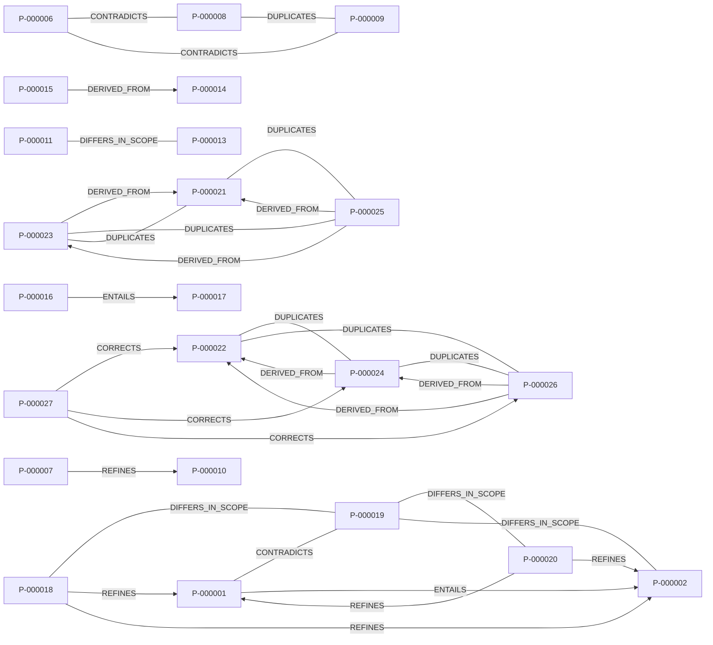

# Demo corpus analysis

Generated 2026-10-12T00:00:00+00:00 · engine upae-0.1.0 · model calls: 0 · deterministic extraction: 29/29

Corpus: 18 sources · 19 passages · 29 propositions · 31 relations · 12 issues (**9 red**). Compression: 323 source words → 172 words in 23 core statements (ratio 0.53).

Status counts: CONFLICTING_EVIDENCE 1, CONTRADICTED 1, HUMAN_REVIEW_REQUIRED 6, INSUFFICIENT_EVIDENCE 6, OUT_OF_SCOPE 2, RETRACTED 1, SUPPORTED 2, UNVERIFIED 10

Notation: `pred(subject, object) = value | scope`; `¬` negation, `◇` hedged, `F` predicted, `X ⊢` attributed to X. 🔴 = carries a red issue (a detected problem, not proof of falsity).

## 1. Core propositions

1. 🔴 **P-000021** `increased(sales of lumora) : from 2.0 million to 2.6 million | t=2023` — HUMAN_REVIEW_REQUIRED · S-000013 T-000014
2. 🔴 **P-000006** `has_value(population of norvik) = 1.2 million | t=2020` — CONTRADICTED · S-000004 p.112 §4.2 Northern cities T-000004
3. 🔴 **P-000002** `Dr. Velin ⊢ ◇decreases(lumora tablets, migraine frequency)` — INSUFFICIENT_EVIDENCE · S-000002 §Why I switched to Lumora T-000001
4. 🔴 **P-000001** `decreases(lumora tablets, migraine frequency) = −30%` — CONFLICTING_EVIDENCE · S-000002 §Why I switched to Lumora T-000001
5. 🔴 **P-000017** `decreases(vitamin q, fracture risk) | pop=older adults` — HUMAN_REVIEW_REQUIRED · S-000011 T-000011
6. 🔴 **P-000019** `¬decreases(lumora tablet, migraine frequency) | pop=children` — INSUFFICIENT_EVIDENCE · S-000012 §Abstract T-000012
7. **P-000008** `has_value(population of norvik) = 951,000 | t=2020` — SUPPORTED · S-000005 T-000005
8. 🔴 **P-000029** `decreases(programme, cost)` — HUMAN_REVIEW_REQUIRED · S-000018 T-000019
9. 🔴 **P-000028** `has_value(unemployment rate) = 1.6 percent | t=2023; loc=Norvik` — HUMAN_REVIEW_REQUIRED · S-000018 T-000019
10. 🔴 **P-000015** `increases(oat milk, exam scores)` — UNVERIFIED · S-000009 T-000009
11. **P-000010** `is_defined_as(unemployment rate, share of the labour force without work)` — INSUFFICIENT_EVIDENCE · S-000006 T-000006
12. **P-000011** `decreases(congestion charging, traffic) = −18% | t=2019; loc=Norvik` — UNVERIFIED · S-000007 T-000007
13. **P-000027** `employs(lumora plant, 900 workers) = 900 | loc=Norvik` — UNVERIFIED · S-000016 T-000017
14. **P-000018** `decreases(lumora tablet, migraine frequency) = −30% | pop=400 adults; cond=supervised dosing; cond=a randomized controlled trial` — UNVERIFIED · S-000012 §Abstract T-000012
15. **P-000020** `◇decreases(tablet, migraine frequency) | pop=adults; cond=under supervised dosing` — UNVERIFIED · S-000012 §Discussion T-000013
16. **P-000013** `increases(congestion charging, traffic) = +3% | t=2021; loc=Velport` — UNVERIFIED · S-000008 T-000008
17. **P-000004** `has_value(노르빅의 실업률) = 6.1퍼센트 | t=2023년` — UNVERIFIED · S-000003 T-000003
18. **P-000014** `correlates_with(oat milk consumption, higher exam scores) | pop=students` — UNVERIFIED · S-000009 T-000009
19. **P-000012** `[opinion] is(congestion charge, best policy norvik has adopted)` — OUT_OF_SCOPE · S-000007 T-000007
20. **P-000003** `[opinion] is(lumora, best migraine treatment on the market)` — OUT_OF_SCOPE · S-000002 §Why I switched to Lumora T-000002
21. **P-000005** `¬decreases(프로그램, 비용)` — UNVERIFIED · S-000003 T-000003
22. **P-000007** `is_defined_as(unemployment rate, share without work) | pop=all adults` — UNVERIFIED · S-000004 p.112 §4.2 Northern cities T-000004
23. **P-000016** `decreases(vitamin q, fracture risk) = −50% | pop=older adults` — RETRACTED · S-000010 T-000010

## 2. Relationship graph

- R-000016: P-000001 ↔CONTRADICTS↔ P-000019 [polarity] (conf 0.77, needs_review) — Claims conflict on polarity but population is specified for only one of them; contradiction depends on unstated scope.
- R-000018: P-000006 ↔CONTRADICTS↔ P-000008 [value] (conf 0.78, auto_deterministic) — Same entities, predicate and scope; incompatible on value.
- R-000019: P-000006 ↔CONTRADICTS↔ P-000009 [value] (conf 0.78, auto_deterministic) — Same entities, predicate and scope; incompatible on value.
- R-000023: P-000027 →CORRECTS P-000022 [value] (conf 0.90, auto_deterministic) — S-000016 is a declared correction of S-000013; conflicting claim superseded.
- R-000024: P-000027 →CORRECTS P-000024 [value] (conf 0.90, auto_deterministic) — S-000016 is a declared correction of S-000014; conflicting claim superseded.
- R-000025: P-000027 →CORRECTS P-000026 [value] (conf 0.90, auto_deterministic) — S-000016 is a declared correction of S-000015; conflicting claim superseded.
- R-000001: P-000015 →DERIVED_FROM P-000014 (conf 0.70, asserted_by_source) — Source presents this as a conclusion ('therefore').
- R-000026: P-000023 →DERIVED_FROM P-000021 (conf 0.60, needs_review) — S-000014 reproduces S-000013; reworded sentence anchored by shared numbers and terms.
- R-000027: P-000025 →DERIVED_FROM P-000021 (conf 0.60, needs_review) — S-000015 reproduces S-000013; reworded sentence anchored by shared numbers and terms.
- R-000028: P-000024 →DERIVED_FROM P-000022 (conf 0.60, needs_review) — S-000014 reproduces S-000013; reworded sentence anchored by shared numbers and terms.
- R-000029: P-000026 →DERIVED_FROM P-000022 (conf 0.60, needs_review) — S-000015 reproduces S-000013; reworded sentence anchored by shared numbers and terms.
- R-000030: P-000025 →DERIVED_FROM P-000023 (conf 0.60, needs_review) — S-000015 reproduces S-000014; reworded sentence anchored by shared numbers and terms.
- R-000031: P-000026 →DERIVED_FROM P-000024 (conf 0.60, needs_review) — S-000015 reproduces S-000014; reworded sentence anchored by shared numbers and terms.
- R-000017: P-000002 ↔DIFFERS_IN_SCOPE↔ P-000019 [modality] (conf 0.77, auto_deterministic) — At least one claim is hedged/predicted (possible vs asserted); a possibility does not contradict an assertion.
- R-000020: P-000011 ↔DIFFERS_IN_SCOPE↔ P-000013 [time, location] (conf 0.79, auto_deterministic) — Claims look incompatible on direction, magnitude but differ in time, location; they are not contradictory as stated.
- R-000021: P-000018 ↔DIFFERS_IN_SCOPE↔ P-000019 [population] (conf 0.79, auto_deterministic) — Claims look incompatible on polarity but differ in population; they are not contradictory as stated.
- R-000022: P-000019 ↔DIFFERS_IN_SCOPE↔ P-000020 [population] (conf 0.66, auto_deterministic) — Claims look incompatible on polarity but differ in population; they are not contradictory as stated.
- R-000008: P-000008 ↔DUPLICATES↔ P-000009 (conf 0.90, auto_deterministic) — Same entities, predicate, polarity, value and scope.
- R-000010: P-000021 ↔DUPLICATES↔ P-000023 (conf 0.90, auto_deterministic) — Same entities, predicate, polarity, value and scope.
- R-000011: P-000021 ↔DUPLICATES↔ P-000025 (conf 0.90, auto_deterministic) — Same entities, predicate, polarity, value and scope.
- R-000012: P-000022 ↔DUPLICATES↔ P-000024 (conf 0.90, auto_deterministic) — Same entities, predicate, polarity, value and scope.
- R-000013: P-000022 ↔DUPLICATES↔ P-000026 (conf 0.90, auto_deterministic) — Same entities, predicate, polarity, value and scope.
- R-000014: P-000023 ↔DUPLICATES↔ P-000025 (conf 0.90, auto_deterministic) — Same entities, predicate, polarity, value and scope.
- R-000015: P-000024 ↔DUPLICATES↔ P-000026 (conf 0.90, auto_deterministic) — Same entities, predicate, polarity, value and scope.
- R-000002: P-000001 →ENTAILS P-000002 (conf 0.90, auto_deterministic) — The quantified claim implies the unquantified claim (same scope).
- R-000009: P-000016 →ENTAILS P-000017 (conf 0.90, auto_deterministic) — The quantified claim implies the unquantified claim (same scope).
- R-000003: P-000018 →REFINES P-000001 [population, conditions] (conf 0.90, auto_deterministic) — Same claim with additional scope restrictions (population, conditions).
- R-000004: P-000020 →REFINES P-000001 [population, conditions] (conf 0.70, auto_deterministic) — Same claim with additional scope restrictions (population, conditions).
- R-000005: P-000018 →REFINES P-000002 [population, conditions] (conf 0.90, auto_deterministic) — Same claim with additional scope restrictions (population, conditions).
- R-000006: P-000020 →REFINES P-000002 [population, conditions] (conf 0.70, auto_deterministic) — Same claim with additional scope restrictions (population, conditions).
- R-000007: P-000007 →REFINES P-000010 [population] (conf 0.74, auto_deterministic) — Same claim with additional scope restrictions (population).

## 3. Confirmed findings

1. **P-000008** `has_value(population of norvik) = 951,000 | t=2020` — S=0.90 from 1 independent group(s) (G-000006); evidence E-000006.
2. **P-000009** `has_value(population of norvik) = 950,000 | t=2020` — S=0.90 from 1 independent group(s) (G-000005); evidence E-000007.

## 4. Red-flagged problems

### 4.1 🔴 I-000002 — NUMERICAL_INCONSISTENCY (PROBABLE_ERROR)

1. **Affected:** P-000006 `has_value(population of norvik) = 1.2 million | t=2020` (S-000004 p.112 §4.2 Northern cities T-000004), P-000008 `has_value(population of norvik) = 951,000 | t=2020` (S-000005 T-000005), P-000009 `has_value(population of norvik) = 950,000 | t=2020` (S-000006 T-000006)
2. **Category:** NUMERICAL_INCONSISTENCY · class PROBABLE_ERROR
3. **Conflicting / relevant:** P-000006, P-000008, P-000009
4. **Reason:** P-000006 [has_value(population of norvik) = 1.2 million | t=2020] vs P-000008 [has_value(population of norvik) = 951,000 | t=2020]: Same entities, predicate and scope; incompatible on value. Independent evidence favours P-000008, P-000009 (S=0.90) over P-000006 (C=1.80); both are kept.
5. **Severity / confidence:** HIGH / 0.78 (deterministic rule: rule:contradiction@1)
6. **Evidence:** T-000004 (S-000004): “Norvik had a population of 1.2 million in 2020. The unemployment rate is defined as the share of all adults without work.”; T-000005 (S-000005): “The population of Norvik was 951,000 in 2020.”; T-000006 (S-000006): “Norvik had a population of 950,000 in 2020. The unemployment rate is defined as the share of the labour force without work.”
7. **Would resolve:** Consult primary evidence (original data, measurement protocol) for 'population of norvik' under the shared scope; check definitions and measurement methods. Neither side is discarded.
   - Assumptions: Assumed both refer to the same location (neither proposition states it). Assumed both refer to the same population (neither proposition states it). Assumed both hold under the same conditions (neither proposition states it).

### 4.2 🔴 I-000003 — ARITHMETIC_ERROR (CONFIRMED_ERROR)

1. **Affected:** P-000021 `increased(sales of lumora) : from 2.0 million to 2.6 million | t=2023` (S-000013 T-000014), P-000023 `increased(sales of lumora) : from 2.0 million to 2.6 million | t=2023` (S-000014 T-000015), P-000025 `increased(sales of lumora) : from 2.0 million to 2.6 million | t=2023` (S-000015 T-000016)
2. **Category:** ARITHMETIC_ERROR · class CONFIRMED_ERROR
3. **Conflicting / relevant:** —
4. **Reason:** In “from 2.0 million to 2.6 million packs in 2023, a 40% increase”: stated 40% but (2.6 − 2) / 2 = +30.0%. Repeated in 3 passages sharing origin G-000013.
5. **Severity / confidence:** HIGH / 0.95 (deterministic rule: rule:arithmetic-percent_change@1)
6. **Evidence:** T-000014 (S-000013): “Sales of Lumora rose from 2.0 million to 2.6 million packs in 2023, a 40% increase. The Lumora plant in Norvik employs 1,200 workers.”; T-000015 (S-000014): “Sales of Lumora rose from 2.0 million to 2.6 million packs in 2023, a 40% increase. The Lumora plant in Norvik employs 1,200 workers.”; T-000016 (S-000015): “Sales of Lumora rose from 2.0 million to 2.6 million packs in 2023, a 40% increase, the wire reported. The Lumora plant in Norvik employs 1,200 workers.”
7. **Would resolve:** Check the original figures; at least one of the stated numbers is wrong. The computation is deterministic, the faulty number is not identified.

### 4.3 🔴 I-000004 — MISLEADING_QUOTATION (PROBABLE_ERROR)

1. **Affected:** P-000002 `Dr. Velin ⊢ ◇decreases(lumora tablets, migraine frequency)` (S-000002 §Why I switched to Lumora T-000001)
2. **Category:** MISLEADING_QUOTATION · class PROBABLE_ERROR
3. **Conflicting / relevant:** —
4. **Reason:** Quotation is verbatim but omits qualifying context present in the original (but, only, under): “The tablet may reduce migraine frequency in adults, but only under supervised dosing.”.
5. **Severity / confidence:** HIGH / 0.70 (deterministic rule: rule:quote-context@1)
6. **Evidence:** T-000001 (S-000002): “Lumora tablets reduce migraine frequency by 30%. Dr. Velin said "the tablet may reduce migraine frequency".”
7. **Would resolve:** Compare with the full original sentence; report the qualifier.

### 4.4 🔴 I-000005 — TRANSLATION_DISCREPANCY (PROBABLE_ERROR)

1. **Affected:** P-000028 `has_value(unemployment rate) = 1.6 percent | t=2023; loc=Norvik` (S-000018 T-000019)
2. **Category:** TRANSLATION_DISCREPANCY · class PROBABLE_ERROR
3. **Conflicting / relevant:** —
4. **Reason:** Translation S-000018 sentence “The unemployment rate in Norvik was 1.6 percent in 2023.” vs original S-000017 (de) “Die Arbeitslosenquote in Norvik lag 2023 bei 6,1 Prozent.”: numbers differ: ['6.1', '2023'] vs ['1.6', '2023'].
5. **Severity / confidence:** HIGH / 0.85 (deterministic rule: rule:translation-cues@1)
6. **Evidence:** S-000017 (Arbeitsmarkt Norvik (synthetisches Beispiel)); S-000018 (Norvik labour market (English translation, synthetic example))
7. **Would resolve:** Have the sentence re-translated or checked by a fluent reader; prefer the original-language source.

### 4.5 🔴 I-000006 — TRANSLATION_DISCREPANCY (PROBABLE_ERROR)

1. **Affected:** P-000029 `decreases(programme, cost)` (S-000018 T-000019)
2. **Category:** TRANSLATION_DISCREPANCY · class PROBABLE_ERROR
3. **Conflicting / relevant:** —
4. **Reason:** Translation S-000018 sentence “The programme can reduce costs.” vs original S-000017 (de) “Das Programm kann die Kosten nicht senken.”: negation present in first, absent in second.
5. **Severity / confidence:** HIGH / 0.75 (deterministic rule: rule:translation-cues@1)
6. **Evidence:** S-000017 (Arbeitsmarkt Norvik (synthetisches Beispiel)); S-000018 (Norvik labour market (English translation, synthetic example))
7. **Would resolve:** Have the sentence re-translated or checked by a fluent reader; prefer the original-language source.

### 4.6 🔴 I-000007 — UNSUPPORTED_CAUSAL_CLAIM (PROBABLE_ERROR)

1. **Affected:** P-000015 `increases(oat milk, exam scores)` (S-000009 T-000009)
2. **Category:** UNSUPPORTED_CAUSAL_CLAIM · class PROBABLE_ERROR
3. **Conflicting / relevant:** P-000014
4. **Reason:** Conclusion P-000015 [increases(oat milk, exam scores)] marked 'therefore': A causal conclusion is drawn from correlational/observational premises.
5. **Severity / confidence:** HIGH / 0.75 (deterministic rule: rule:inference-correlation_to_causation@1)
6. **Evidence:** T-000009 (S-000009): “Oat milk consumption is associated with higher exam scores among students. Therefore, oat milk improves exam scores.”
7. **Would resolve:** Evidence from a randomised or otherwise causally identified design, or an explicit argument ruling out confounding.

### 4.7 🔴 I-000008 — INVALID_INFERENCE (PROBABLE_ERROR)

1. **Affected:** P-000015 `increases(oat milk, exam scores)` (S-000009 T-000009)
2. **Category:** INVALID_INFERENCE · class PROBABLE_ERROR
3. **Conflicting / relevant:** P-000014
4. **Reason:** Conclusion P-000015 [increases(oat milk, exam scores)] marked 'therefore': Conclusion drops scope restrictions of its premise: population=students.
5. **Severity / confidence:** HIGH / 0.70 (deterministic rule: rule:inference-overgeneralisation@1)
6. **Evidence:** T-000009 (S-000009): “Oat milk consumption is associated with higher exam scores among students. Therefore, oat milk improves exam scores.”
7. **Would resolve:** Evidence that the result holds beyond the premise's scope, or restate the conclusion with the premise's restrictions.

### 4.8 🔴 I-000011 — RETRACTED_SOURCE_DEPENDENCY (PROBABLE_ERROR)

1. **Affected:** P-000017 `decreases(vitamin q, fracture risk) | pop=older adults` (S-000011 T-000011)
2. **Category:** RETRACTED_SOURCE_DEPENDENCY · class PROBABLE_ERROR
3. **Conflicting / relevant:** S-000010
4. **Reason:** P-000017 [decreases(vitamin q, fracture risk) | pop=older adults] comes from S-000011, which relies on retracted source(s) S-000010.
5. **Severity / confidence:** HIGH / 0.80 (deterministic rule: rule:retraction@1)
6. **Evidence:** S-000010 (Vitamin Q and fractures (synthetic example, retracted))
7. **Would resolve:** Find independent, non-retracted evidence for the claim or withdraw it.

### 4.9 🔴 I-000001 — MISSING_CONDITION (UNRESOLVED_CONTRADICTION)

1. **Affected:** P-000001 `decreases(lumora tablets, migraine frequency) = −30%` (S-000002 §Why I switched to Lumora T-000001), P-000019 `¬decreases(lumora tablet, migraine frequency) | pop=children` (S-000012 §Abstract T-000012)
2. **Category:** MISSING_CONDITION · class UNRESOLVED_CONTRADICTION
3. **Conflicting / relevant:** P-000001, P-000019
4. **Reason:** P-000001 [decreases(lumora tablets, migraine frequency) = −30%] and P-000019 [¬decreases(lumora tablet, migraine frequency) | pop=children] conflict on polarity, but population is stated only for one of them. Claims conflict on polarity but population is specified for only one of them; contradiction depends on unstated scope.
5. **Severity / confidence:** MEDIUM / 0.62 (deterministic rule: rule:contradiction@1)
6. **Evidence:** T-000001 (S-000002): “Lumora tablets reduce migraine frequency by 30%. Dr. Velin said "the tablet may reduce migraine frequency".”; T-000012 (S-000012): “In a randomized controlled trial of 400 adults, the Lumora tablet reduced migraine frequency by 30% under supervised dosing. The tablet did not reduce migraine frequency in children.”
7. **Would resolve:** Determine the population that P-000001 refers to; if it matches the other proposition, the contradiction is genuine, otherwise it is a scope difference.
   - Assumptions: Assumed both refer to the same time period (neither proposition states it). Assumed both refer to the same location (neither proposition states it). Assumed both hold under the same conditions (neither proposition states it). Would require that both refer to the same population.

## 5. Conflicting evidence

- **P-000001** CONFLICTING_EVIDENCE `decreases(lumora tablets, migraine frequency) = −30%` — S=0.50, C=0.50. Support S=0.50 and challenge C=0.50; neither dominates.
  - E-000001 supports via P-000018 (S-000012, experimental, primary, indirect, strength 0.5, group G-000012)
  - E-000002 supports via P-000020 (S-000012, experimental, primary, indirect, strength 0.5, group G-000012)
  - E-000021 challenges via P-000019 (S-000012, experimental, primary, indirect, strength 0.5, group G-000012)
- **P-000006** CONTRADICTED `has_value(population of norvik) = 1.2 million | t=2020` — S=0.00, C=1.80. 2 independent challenging group(s), C=1.80 ≥ τ, S=0.00.
  - E-000023 challenges via P-000008 (S-000005, dataset, primary, direct, strength 0.9, group G-000005)
  - E-000025 challenges via P-000009 (S-000006, dataset, primary, direct, strength 0.9, group G-000006)

## 6. Missing conditions or assumptions

- P-000002 vs P-000019: not contradictory — differ in modality. At least one claim is hedged/predicted (possible vs asserted); a possibility does not contradict an assertion.
- P-000011 vs P-000013: not contradictory — differ in time, location. Claims look incompatible on direction, magnitude but differ in time, location; they are not contradictory as stated.
- P-000018 vs P-000019: not contradictory — differ in population. Claims look incompatible on polarity but differ in population; they are not contradictory as stated.
- P-000019 vs P-000020: not contradictory — differ in population. Claims look incompatible on polarity but differ in population; they are not contradictory as stated.
- I-000001: P-000001, P-000019 — P-000001 [decreases(lumora tablets, migraine frequency) = −30%] and P-000019 [¬decreases(lumora tablet, migraine frequency) | pop=children] conflict on polarity, but population is stated only for one of them. Claims conflict on polarity but population is specified for only one of them; contradiction depends on unstated scope. Required: Assumed both refer to the same time period (neither proposition states it). Assumed both refer to the same location (neither proposition states it). Assumed both hold under the same conditions (neither proposition states it). Would require that both refer to the same population.
- R-000016 (P-000001 vs P-000019) is classified as a contradiction under the assumptions: Assumed both refer to the same time period (neither proposition states it). Assumed both refer to the same location (neither proposition states it). Assumed both hold under the same conditions (neither proposition states it). Would require that both refer to the same population.
- R-000018 (P-000006 vs P-000008) is classified as a contradiction under the assumptions: Assumed both refer to the same location (neither proposition states it). Assumed both refer to the same population (neither proposition states it). Assumed both hold under the same conditions (neither proposition states it).
- R-000019 (P-000006 vs P-000009) is classified as a contradiction under the assumptions: Assumed both refer to the same location (neither proposition states it). Assumed both refer to the same population (neither proposition states it). Assumed both hold under the same conditions (neither proposition states it).

## 7. Unresolved questions

- I-000009 UNSUPPORTED_CAUSAL_CLAIM (SUSPICIOUS_CLAIM, MEDIUM, conf 0.60) on P-000011: Causal claim [decreases(congestion charging, traffic) = −18% | t=2019; loc=Norvik] is presented with a observational basis, which cannot by itself establish causation; no experimental evidence was found in the corpus. → Randomised/controlled evidence, or a causal-identification argument.
- I-000010 DEPENDENT_CORROBORATION (MISSING_EVIDENCE, LOW, conf 0.80) on P-000021, P-000022, P-000023, P-000024, P-000025, P-000026: Sources S-000013, S-000014, S-000015 share origin G-000013; 2 claim(s) they repeat are counted once: [increased(sales of lumora) : from 2.0 million to 2.6 million | t=2023] ×3; [employs(lumora plant, 1,200 workers) = 1,200 | loc=Norvik] ×3. No independent origin states these claims. → Find corroboration from a source that does not derive from the same origin.
- I-000012 SOURCE_UNAVAILABLE (LIMITATION, LOW, conf 1.00) on S-000001: Source 'archived_scan' could not be analysed: unavailable (pdf connector could not read the file: PdfStreamError: Stream has ended unexpectedly). → Provide an accessible copy or install the required connector dependency.
- P-000017 needs human review: relies on retracted source S-000010
- P-000021 needs human review: source sentence contains an arithmetic inconsistency
- P-000023 needs human review: source sentence contains an arithmetic inconsistency
- P-000025 needs human review: source sentence contains an arithmetic inconsistency
- P-000028 needs human review: translation may not preserve the original meaning
- P-000029 needs human review: translation may not preserve the original meaning

## 8. Source references

| ID | Kind | Title | Author / Publisher | Date | Locator | Lang | Indep. group | Notes |
|---|---|---|---|---|---|---|---|---|
| S-000001 | other | archived_scan | not stated | not stated | — | und | G-000001 | unavailable |
| S-000002 | web | Why I switched to Lumora (synthetic example) | Sam Example / Example Health Blog | 2023-06-01 | https://blog.example.org/lumora | en | G-000002 |  |
| S-000003 | news | 노르빅 노동시장 (합성 예시) | 예시 신문 | 2024-02-11 | — | ko | G-000003 | synthetic |
| S-000004 | textbook | Introduction to Regional Geography (synthetic example) | R. Example / Example University Press | 2022-09-01 | 000-0-00-000000-0 | en | G-000004 | synthetic |
| S-000005 | dataset | Norvik census tables 2020 (synthetic example) | Norvik Statistics Office | 2021-03-01 | https://stats.example.org/census-2020 | en | G-000005 | synthetic |
| S-000006 | report | Labour market report (synthetic example) | Regional Data Institute | 2021-05-01 | https://rdi.example.org/report | en | G-000006 | synthetic |
| S-000007 | report | Congestion charge evaluation (synthetic example) | Norvik Transport Authority | 2020-02-01 | — | en | G-000007 | synthetic |
| S-000008 | news | Velport traffic rises (synthetic example) | Example Courier | 2022-02-01 | — | en | G-000008 | synthetic |
| S-000009 | social | oat-post | @example_user | 2024-02-02 | — | en | G-000009 | synthetic |
| S-000010 | paper | Vitamin Q and fractures (synthetic example, retracted) | Lee Example | 2018-01-01 | 10.0000/synthetic.0002 | en | G-000010 | synthetic, RETRACTED |
| S-000011 | book | Healthy Ageing Guide (synthetic example) | Example Books | 2019-06-01 | — | und | G-000010 | synthetic, cites S-000010 |
| S-000012 | paper | Supervised Lumora dosing for migraine prevention (synthetic example) | Mara Velin / Journal of Synthetic Examples | 2023-04-12 | 10.0000/synthetic.0001 | en | G-000012 | synthetic |
| S-000013 | news | Lumora sales climb (synthetic example) | Example Wire Service | 2024-01-15 | https://wire.example.org/lumora-sales | en | G-000013 | synthetic |
| S-000014 | news | Lumora sales climb | Example Daily | 2024-01-15 | https://daily.example.com/lumora | en | G-000013 | synthetic, reproduces S-000013, duplicate of S-000013 |
| S-000015 | news | Lumora's sales surge | Example Times | 2024-01-16 | https://times.example.com/lumora | en | G-000013 | synthetic, duplicate of S-000013 |
| S-000016 | news | Correction: Lumora plant workforce | Example Wire Service | 2024-01-17 | https://wire.example.org/lumora-correction | en | G-000016 | synthetic |
| S-000017 | news | Arbeitsmarkt Norvik (synthetisches Beispiel) | Beispiel Zeitung | 2024-02-10 | — | de | G-000017 | synthetic |
| S-000018 | news | Norvik labour market (English translation, synthetic example) | Beispiel Zeitung | 2024-02-10 | — | en | G-000017 | synthetic, translation of S-000017 |

Metadata is reported only where present in the source; missing fields are marked 'not stated'.

## 9. Confidence and limitations

- Extraction is rule-based (English). 0 proposition(s) used the low-confidence fallback pattern and are marked for review.
- Confidence values are heuristic scores from documented formulas, not calibrated probabilities; see EVALUATION_REPORT.md for measured calibration.
- Status reflects only evidence present in this corpus; it is not a verdict on truth.
- Source S-000001 ('archived_scan') not analysed: unavailable — pdf connector could not read the file: PdfStreamError: Stream has ended unexpectedly

## 10. Changes since the previous analysis

No previous analysis supplied.

## Appendix: timeline

No dated episodes or predictions found.

## Appendix: omitted, merged and summarised propositions

Counts: merged 6

- P-000023: merged → P-000021 — duplicate of P-000021
- P-000025: merged → P-000021 — duplicate of P-000021
- P-000009: merged → P-000008 — duplicate of P-000008
- P-000022: merged → P-000027 — superseded by correction P-000027
- P-000024: merged → P-000027 — superseded by correction P-000027
- P-000026: merged → P-000027 — superseded by correction P-000027

### Status legend

- **SUPPORTED** — independent support ≥ τ, no comparable challenge
- **CONTRADICTED** — independent challenge ≥ τ (or deterministic proof), no comparable support
- **CONFLICTING_EVIDENCE** — support and challenge both present
- **INSUFFICIENT_EVIDENCE** — only dependent copies or weak evidence
- **UNVERIFIED** — no evidence beyond the assertion itself
- **OUT_OF_SCOPE** — opinion / normative — recorded, not assessed as fact
- **RETRACTED** — from a retracted source
- **HUMAN_REVIEW_REQUIRED** — a review trigger fired
